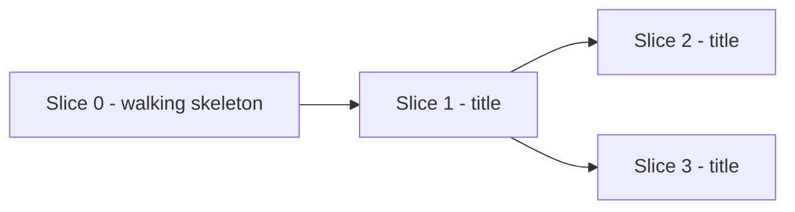

# NHS Product Backlog

Use this skill to decompose user journeys into stories with acceptance criteria, then group and prioritise them into a build backlog for the NHS Service Builder to implement.

Produce user story files and a build backlog. Do **not** write application code, tests, or infrastructure.

## Prerequisites

Before using this skill, the architecture must already be designed. Run the **NHS Architect** role first — it produces:
- `docs/adr/001-architecture.md` — agreed architecture with API endpoints, data models, frontend pages, and journey priority order
- `docs/adr/002-dependency-strategy.md` — what is real, sandbox or mock for each dependency in the alpha
- Discovery artefacts: `discovery/scenarios/scenario.md`, `discovery/personas/persona-report.md`, `discovery/user_journeys/data/journey-*.md`

**Guard**: if `docs/adr/001-architecture.md` or `docs/adr/002-dependency-strategy.md` does not exist, stop. Tell the user to run the **NHS Architect** agent with the `nhs-architecture-design` skill first. Do not write stories without them.

## User Story Standards

Read `.github/skills/nhs-user-stories/SKILL.md` for the story format, NHS persona archetypes, and acceptance criteria categories. Every story must follow those standards.

## Workflow

### Step 1 — Read Discovery and Architecture

Read all input artefacts:
1. `discovery/scenarios/scenario.md` — problem statement and scope
2. `discovery/personas/persona-report.md` — the personas this service is for
3. `discovery/user_journeys/data/journey-*.md` — the journeys to decompose
4. `docs/adr/001-architecture.md` — API endpoints, data models, frontend pages, and priority order

Summarise what you found and confirm with the user:
> I've read the discovery artefacts and architecture. Here are the journeys I'll decompose into stories: [list]. Is this correct?

**Wait for the user's response before proceeding.**

### Step 2 — Decompose Journeys into Stories

For each journey (in priority order from the ADR), identify the discrete user stories. Each journey typically produces 3–8 stories.

**How to decompose a journey into stories:**
- Each step or decision point in the journey that delivers independent value is a candidate story
- A story should be implementable in isolation — it has a clear API endpoint, frontend page/component, or data operation
- Use the personas from the persona report (not the generic archetypes) as the "As a..." in each story
- Map each story to the technical design in the ADR — the API endpoint, data model, and frontend page it requires

**Story scope rules:**
- Do not create stories for documentation tasks — documentation is not a user story
- Stories that require Azure services (Entra ID, Azure Monitor, Key Vault, etc.) are valid — the Service Builder will implement them using real Azure SDKs and configuration
- Stories that require NHS API integrations are valid — use the alpha approach in `docs/adr/002-dependency-strategy.md`: the real system, the NHS sandbox, or the external mock service
- Every journey step gets a story — do not defer or filter out stories based on infrastructure complexity

**Gap analysis — after decomposing each journey:**
- Walk through the original journey step by step and verify every step is covered by at least one story
- Check for missing connecting functionality: navigation between pages, shared layout/header/footer, error states, loading states, "back" flows
- Check for cross-journey gaps: shared components, common data operations, or transitions between journeys
- If you find gaps, add stories to cover them — mark them with `**Gap fill**` in the journey reference field

**End-to-end completeness check — the stories must be sufficient to complete each journey from start to finish.** After the gap analysis, confirm that, if every story for a journey were implemented, a real user could complete that journey end to end with nothing missing:
- **Entry point** — there is a story that lets the actor start the journey (landing page, sign-in, or first action in the journey's Main Flow)
- **Preconditions** — everything in the journey's **Preconditions** is satisfied by a story or an explicit dependency (e.g. authentication, an existing record, a prior journey). If a precondition is not covered, add a `**Gap fill**` story or note the dependency
- **Every step connects** — each step's output feeds the next; there are no orphan stories and no steps that depend on functionality no story provides (data, navigation, state)
- **Decision points** — every branch/path and edge case in the journey's **Decision Points** is reachable and handled by a story
- **Success Criteria** — there is a story whose acceptance criteria deliver the journey's stated **Success Criteria**, so the journey reaches its defined end state
- If any of these are not met, add or split stories until the set is complete. Do not leave a journey that cannot be completed end to end.

### Step 3 — Write Acceptance Criteria

Every story MUST include acceptance criteria in these four categories (from the `nhs-user-stories` skill):

1. **Functional** — Given/When/Then format for testable behaviour. Include happy path and key edge cases.
2. **Accessibility** — Keyboard navigation, screen reader, WCAG 2.2 Level AA, NHS Design System components
3. **Clinical Safety** — Data accuracy, error handling, time-sensitivity (if applicable — mark "N/A" if the story has no clinical data)
4. **Data Protection** — Minimum data collection, no PII in URLs/logs/errors, lawful basis

### Step 4 — Save Stories

Save each story as a separate file in `user_stories/` **before** presenting them for review. Do not type out full story content in the chat — save to files so the team can review them properly.

**Naming convention**: `user_stories/story-NNN-short-slug.md` (e.g. `user_stories/story-001-view-available-slots.md`)

**File format**:
```markdown
# Story NNN — [Title]

**Journey**: [journey name/file reference]
**Priority**: [number from ADR priority order]
**Slice**: [slice number, added in Step 6]
**Status**: Not ready — build context incomplete

## User Story

As a [persona],
I need to [action],
So that [benefit].

## Acceptance Criteria

### Functional
- [ ] Given [context], when [action], then [outcome]
- [ ] Given [context], when [action], then [outcome]

### Accessibility
- [ ] Keyboard navigable (Tab, Enter, Escape, Arrow keys)
- [ ] Screen reader announces purpose and state changes
- [ ] Meets WCAG 2.2 Level AA (verified via axe-core)
- [ ] Uses NHS Design System components

### Clinical Safety
- [ ] [criteria or N/A]

### Data Protection
- [ ] [criteria]

## Build Context

<!-- The NHS Product Owner fills the first 3 fields. The NHS Architect completes the rest in its second pass. -->

- **Depends on**: [story-NNN, or none]
- **Answered questions**: [Q-NNN — the direction in one sentence, or none]
- **Out of scope**: [what this story does not do]
- **ADRs**: [ADR-NNN — the decision in one sentence]
- **API contract**: [METHOD /path — request fields and types — response fields and types]
- **Data model**: [entities and fields read or written]
- **Pages and components**: [route — NHS Design System components]
- **Files to create or change**: [paths]
- **External dependencies**: [system — Real / Sandbox / Mock (from ADR-002) — `[SYSTEM]_BASE_URL`]
- **Synthetic data**: [records the story needs]
- **Validation commands**: [exact test and lint commands]
```

A story is **ready** when its build context is complete and no open question in `discovery/open-questions.md` blocks it. Always save a new story as `Not ready — build context incomplete`. The NHS Architect sets it to `Ready` in its second pass. The build context must answer the questions an engineer would ask, so that an agent on a lower-cost model can build the story without design decisions. If you find a question that you cannot answer from the discovery artefacts or the ADRs, add it to `discovery/open-questions.md` with the `decision` skill, and link it in **Answered questions** when it is answered.

### Step 5 — Present Story List for Confirmation

After saving all files, present **only the story titles** grouped by journey — do **not** type out full stories or acceptance criteria in the chat. The team will review the files directly.

Format:

> I've saved **N** user stories to `user_stories/`. Here's the summary:
>
> **Journey: [journey name]**
> 1. Story 001 — [title]
> 2. Story 002 — [title]
> 3. Story 003 — [title]
>
> **Journey: [journey name]**
> 4. Story 004 — [title]
> 5. Story 005 — [title]
>
> I've checked each journey end to end: the stories above cover the entry point, preconditions, every step and decision point, and the journey's success criteria — so each journey can be completed from start to finish.
>
> Please review the story files in `user_stories/` and let me know if you want to add, remove, split, or re-prioritise any stories.

**Wait for the user's response.** If they request changes, edit the relevant files directly.

### Step 6 — Recommend Slices and Build the Backlog

Once the stories are confirmed, group them into **slices** and order the slices. Save the result to `user_stories/backlog.md`.

**What a slice is.** A slice is a set of stories that you build, review and show together. There are two types. The user chooses the type for each slice:

| Type | What it delivers | Use it when |
|---|---|---|
| **Thin slice** | The shortest end-to-end path that proves one assumption. It can be part of a journey. Later slices add the other steps | The riskiest assumption must be tested early, or time is short (for example a 2-day workshop, where you may build only 1 slice) |
| **Journey slice** | One complete journey, including its failure paths | The journey is short, or the team must show the complete journey |

Example: the journey "Book an appointment" has 5 steps: sign in, find a slot, choose it, confirm, get a reminder. A thin slice is "find a slot and confirm it, with a test user". A journey slice is all 5 steps.

**Slice 0** is always the walking skeleton: the scaffold, the shared layout, the CI pipeline and the deployment. It has no user stories. The NHS Service Builder builds it.

**How to recommend slices:**
1. Start from the journey order that the user agreed with the NHS Architect (in `docs/adr/001-architecture.md`).
2. **Ask the user** which slice type they want for the first slice: thin slice or journey slice. Give your recommendation and the reason.
3. Put the stories for each slice together. Each slice must be demonstrable end to end on the deployed service.
4. **Record the dependencies.** For each slice, list the slices it depends on, and the external dependencies with their alpha approach from `docs/adr/002-dependency-strategy.md` (real, sandbox or mock).
5. **Mark the slices that can run in parallel.** Two slices can run in parallel only if neither depends on the other, and they do not change the same pages, data model or migrations.
6. Order the slices: the user's priority and the riskiest assumption first, then the dependencies.

Present the proposed slices, their types and their order in the chat. **Wait for the user to approve or reorder them.** Then add the **Slice** field to each story file, and save `user_stories/backlog.md`:

````markdown
# Build Backlog

Build the slices in the order below. Each slice can be shown end to end on the deployed service once built.



## Slice 0 — Walking skeleton
**Type**: Foundation
**Delivers**: scaffold, shared layout, CI pipeline, deployment
**Issue**: #[number]

## Slice 1 — [Title]
**Type**: Thin slice / Journey slice
**Journey**: [journey name]
**Tests the assumption**: [the riskiest assumption]
**Depends on**: Slice 0
**External dependencies**: [system — Real / Sandbox / Mock]
**Can run in parallel with**: [Slice N, or none]
**Issue**: #[number]
- Story 001 — [title] — Ready
- Story 002 — [title] — Not ready (Q-003)
````

### Step 7 — Create One GitHub Issue for Each Slice

Do this step after the user approves `user_stories/backlog.md`, in both delivery modes. The journeys and the stories stay in their Markdown files. The issue links to them. It does not copy them.

1. Check that `gh` is available and signed in with `gh auth status`. If it is not, stop. Tell the user that `gh` is not available or not signed in. Do not continue.
1. Make a list of the issues, in backlog order:
   - **Title**: `Slice N — [title]`
   - **Body**: use the template below
   - **Labels**: `slice-N`, and one label for the journey (for example `journey-book-appointment`)
1. Check for open and closed issues with the same title. Use `gh issue list --state all --search "Slice N in:title"`. Do not create a duplicate. Show the existing issue number instead.
1. Show the list to the user. Mark each issue as "new" or "exists". **Wait for confirmation.**
1. Create each new issue in backlog order with `gh issue create --title "..." --body-file <file> --label "..."`. Create a label first with `gh label create` if it does not exist. Do **not** use `--assignee`.
1. Record the issue number of each slice in `user_stories/backlog.md`.

Issue body template:

```markdown
## Slice N — [title]

**Type**: Thin slice / Journey slice
**Tests the assumption**: [assumption]
**Depends on**: [Slice N (#issue), or none]
**Can run in parallel with**: [Slice N, or none]

### Read first
- Backlog: `user_stories/backlog.md`
- Journey: `discovery/user_journeys/data/journey-[name].md`
- ADRs: `docs/adr/001-architecture.md`, `docs/adr/002-dependency-strategy.md`, [other ADRs]

### Stories
Build each story from its file. The **Build context** section in each file gives the API contract, data model, pages, files, external dependencies and validation commands.
- [ ] `user_stories/story-001-[slug].md`
- [ ] `user_stories/story-002-[slug].md`

### Definition of done
- [ ] All acceptance criteria in each story file are marked `[x]`
- [ ] Unit, integration and E2E tests pass, with axe checks on each page
- [ ] CI passes on the pull request
- [ ] Engineering review in Review mode is complete, with no open Critical or High findings
- [ ] Deployed by the pipeline, and shown end to end on the live URL
- [ ] Readiness issues for this slice created with the `alpha-readiness-issues` skill (slice mode)
```

Update the issue when a story changes status. If a story is **Not ready**, write the blocking `Q-NNN` in the issue.

### Handoff

Once the user confirms the stories, the slices and the issues, tell them:
> User stories are in `user_stories/`, the slices are in `user_stories/backlog.md`, and each slice has a GitHub issue. Switch to the **NHS Architect** agent for the second pass: it writes the ADRs that the stories need, checks the slice order, and completes the build context in each story. Then switch to the **NHS Service Builder** agent to build slice 0, then each slice in order.

## Rules

- **Save first, then summarise** — never type out full stories in the chat; save to files and present only titles
- **Every journey must be completable end to end** — the stories for a journey, taken together, must cover its entry point, preconditions, every step and decision point, and its success criteria; never leave a journey that cannot be completed from start to finish. A thin slice may deliver part of a journey, but the backlog must complete each journey
- **One file per story** — each story must be independently referenceable
- **The user chooses the slice type** — recommend thin slice or journey slice, with the reason, and wait for the user's choice
- **Each slice is demonstrable** — each slice must be shown end to end on the deployed service once built
- **Record dependencies and parallel slices** — never mark two slices as parallel if one depends on the other, or both change the same pages or data model
- **Use personas from the persona report** — adapt the generic archetypes from the skill to match the actual personas in `discovery/personas/persona-report.md`
- **All four acceptance criteria categories are mandatory** — use "N/A" for Clinical Safety only if the story genuinely has no clinical data
- **Priority order comes from the user's steer and the ADR** — the Architect agreed the journey order with the user; slices inherit that order, then the dependencies
- **One issue for each slice** — the stories stay in Markdown files; show the issue list and wait for confirmation, never use `--assignee`, and never create a duplicate issue
