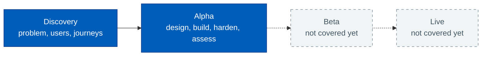

# NHS Delivery Kit

A template for designing and building an NHS digital service with GitHub Copilot.

## Scope: discovery and alpha

The kit covers the **discovery** and **alpha** phases of the [GDS service lifecycle](https://www.gov.uk/service-manual/agile-delivery). It ends at the alpha assessment. It does not cover beta or live yet.

The alpha that you build is for learning and for the alpha assessment. It is not ready for patients. Before a beta, the service needs, for example:

- DCB0129 sign-off by the Clinical Safety Officer.
- DPIA approval by the data protection officer (DPO) or information governance (IG) lead.
- A penetration test, and an operating and support model.

## Two ways to deliver

The kit has one set of agents and skills, and two playbooks:

- **2-day workshop**: discovery is pre-work. Then a team designs and builds an alpha in two days. See the [2-day workshop playbook](docs/playbooks/workshop-2-day/README.md).
- **Multi-week**: a team runs discovery over several weeks, gets sign-off, then builds in sprints. See the [multi-week playbook](docs/playbooks/multi-week/README.md).

The [kit overview](docs/README.md) gives the phases, agents and skills.

## Start

1. Run the `/start-project` skill in GitHub Copilot Chat. Choose the delivery mode.
1. Run the `/problem-statement` skill. The skill creates the discovery scenario and replaces this file with a README for your service. If you have only Microsoft 365 Copilot, use the prompt file [discovery/prompts/problem-statement.md](discovery/prompts/problem-statement.md).
1. In multi-week mode, run the `/discovery-plan` skill.

See the [discovery guide](discovery/README.md) and the
[kit overview](docs/README.md) for the full process.

## Previous version

For the previous workshop-only version of this kit, use the
[`alpha-workshop-v1` release](https://github.com/marrobi/nhs-alpha-workshop/releases/tag/alpha-workshop-v1).

## Licence

[MIT](LICENSE)
