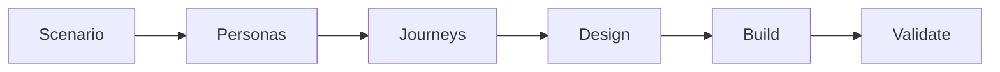

# NHS Alpha Workshop

A template for designing and building an NHS digital service with GitHub Copilot.

Start by running the `/problem-statement` skill in GitHub Copilot Chat. The
skill creates the discovery scenario and replaces this file with a README for
your service. If you have only Microsoft 365 Copilot, use the prompt file
[discovery/prompts/problem-statement.md](discovery/prompts/problem-statement.md).

See the [discovery guide](discovery/README.md) and
[workshop guides](docs/workshop/README.md) for the full process.

## Licence

[MIT](LICENSE)
