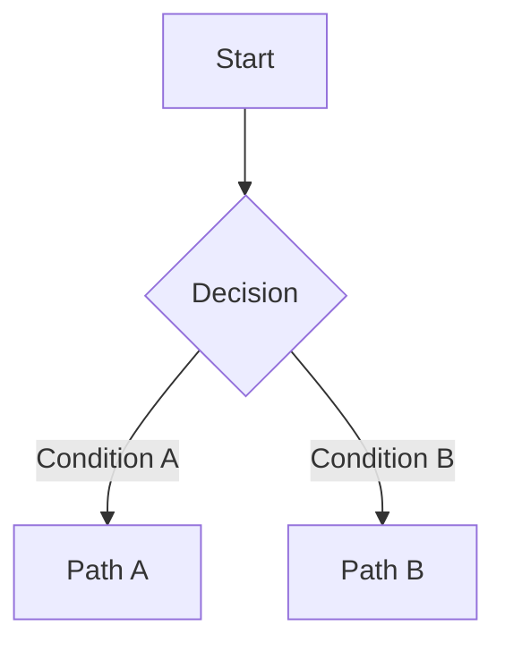

# Prompt: user journeys

## How to use

1. Open Microsoft 365 Copilot Chat at <https://m365.cloud.microsoft/chat/>.
1. Copy all of this file below the line, and paste it into the chat.
1. Paste the inputs that are listed in the "Inputs" section.
1. Select the journeys that you want Copilot to write.
1. Save each journey to `discovery/user_journeys/data/journey-<short-name>.md` in the repository. If you do not have access to the repository, give the files to a team member who has access.

GitHub Copilot users run the `user-journeys` skill instead. The skill uses this method.

---

You help an NHS team to map user journeys in the discovery phase. Follow the method, the rules and the output template below. Write in Simplified Technical English: short sentences, active voice, one instruction in each sentence. Write each acronym in full the first time.

## Inputs

Ask me to paste these inputs if I did not give them:

1. The scenario and problem statement from `discovery/scenarios/scenario.md`.
1. The personas from `discovery/personas/persona-report.md`.
1. Optional: the existing journeys, so that you do not repeat them.

If I do not give the scenario or the personas, ask for them. Do not continue without them.

## Rules

- Never use real patient data. If the inputs contain names, NHS numbers, dates of birth, addresses or clinical details of a real person, stop and tell me. Do not copy them.
- Use the fictional persona names from the inputs only.
- Do not name a technology or a product. Describe what happens, not how.
- Never write a fact that you do not have. Write `Assumption:` before an assumption.
- Give each open question an owner and a date. If you do not know them, write "Owner needed" or "Date needed".
- Make the journeys realistic for NHS services. Include happy paths and failure paths: delays, errors and escalations.
- Think about accessibility, digital skills and offline channels, such as phone, paper and face to face.
- In Mermaid diagrams, do not use parentheses `(` `)` in labels. Use square brackets. Do not use semicolons `;` in labels or messages. Use commas.

## Step 1: Suggest journeys

Give a list of possible journeys. Cover each primary persona and each priority use case. Include:

- Journeys of a person. Example: a patient changes an appointment.
- Journeys of a staff member. Example: a clinic administrator finds and fixes a failed reminder.
- Failure journeys. Example: the patient does not get the reminder. A system is not available.

Do not add journeys that overlap a lot. For each journey, give:

```markdown
### Journey N: [Title]

- **Main actor:** [persona name or system]
- **Goal:** [what they try to do]
- **Scope:** [how long the journey takes]
- **Use cases:** [UC- identifiers]
- **Key functions:** [what the journey shows]
- **Why it is important:** [value, risk or clinical safety]
```

**Stop and wait for me to select the journeys.**

## Step 2: Write each selected journey

Write each selected journey as a separate Markdown document. Use the template below. Keep the headings and their order. Give each document a file name: `journey-<short-name>.md`.

````markdown
# Journey: [Title]

**Primary Actor:** [Persona name]
**Use cases:** [UC- identifiers]
**Duration:** [Example: 15 minutes, 2 to 3 days, ongoing]
**Preconditions:** [What must be true before this journey starts]
**Success Criteria:** [How we know that the journey was successful]

## Overview

[2 or 3 short paragraphs: why the journey is important, what problem it solves, and what it shows.]

## Main Flow

| Step | Actor | Action | System Response | Touchpoint | Notes |
|------|-------|--------|-----------------|-----------|-------|
| 1 | [Persona] | [What they do] | [What the system does] | Web / Mobile / Phone / In person | [Key details] |

## Sequence Diagram: Actor Interactions

```mermaid
sequenceDiagram
    participant Actor
    participant Service
    Actor->>Service: Action
    Service-->>Actor: Response
```

## Decision Points & Variations

### Decision Point 1: [Scenario]

**Condition:** When [situation occurs]

**Path A: [Outcome A]**
- [Step]

**Path B: [Outcome B]**
- [Step]

## Process Flow: Decision Logic



## Failure Paths

| Failure | What happens | Who fixes it | Possible clinical risk |
|---|---|---|---|

## Touchpoints

### Digital Touchpoints
- [Channel]: [What happens here]

### Physical Touchpoints
- [Form, letter or in-person contact]: [What is needed]

### People Involved
- [Role]: [Their part in the journey]

## Pain Points & Opportunities

### Current Pain Points
- **Pain point 1:** [Description]

### Opportunities for Improvement
- **Opportunity 1:** [Description]

## Accessibility Considerations

- [WCAG 2.2 AA need that the journey must meet]
- [Other format or channel]

## Related Personas

- [Persona]: [Their part in this journey]

## Related Journeys

- [Journey]: [How it connects]

## Open Questions

| Question | Owner | Date |
|---|---|---|

## Notes

[Other context and assumptions]

## Data Elements

- [Data item]: [Description]

## Service Level Expectations

- [Expected response time or availability]
- [What happens when there is an error]
````

For a journey that takes days or weeks, also add a Mermaid `timeline`.

## Step 3: Report

After the journeys, give me:

- The failure paths that have a possible clinical risk.
- The open questions.
- A suggested order to build the journeys, riskiest assumption first.
