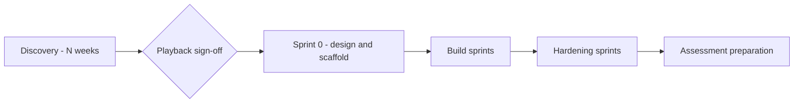

# Multi-week playbook

Use this playbook when a team runs discovery over several weeks, then builds the alpha in sprints. The [phases page](../README.md) gives the method for each phase. This page gives the schedule.

The agents and skills are the same as in the [2-day workshop playbook](../workshop-2-day/README.md). Only the schedule changes.

## Before you start

1. Run the `start-project` skill. Choose the `multi-week` mode. Give the discovery length, the sprint length and the owners.
1. Check that `.github/instructions/delivery-mode.instructions.md` has the correct values.
1. Check which models your organisation's Copilot policy allows. See [Models](../../README.md#models).

## Overview

## Roles

| Role | Person | Main agents |
|---|---|---|
| Product owner | Decides scope and priority. Approves stories and the backlog | NHS Product Owner |
| Delivery lead | Keeps the plan, logs and status current. Runs the playback | NHS Delivery Lead, NHS Discovery Analyst |
| Architect or tech lead | Agrees the architecture and accepts ADRs | NHS Architect |
| Engineers | Build and review the service | NHS Service Builder, NHS Quality Engineer |
| Clinical Safety Officer | Approves the hazard log and the safety case | NHS Clinical Safety |
| Data protection officer (DPO) or information governance (IG) lead | Approves the data protection impact assessment (DPIA) | NHS DPIA Advisor |
| Content designer | Approves user-facing content | NHS Content Designer |

Agents propose. People decide. Record who agreed each decision, and when.

## Cadence

| When | What happens | Agent and skill |
|---|---|---|
| Each discovery week | Workshops, logs, gap check and status | See the weekly rhythm in `discovery/plan.md` |
| End of discovery | Playback and sign-off | NHS Delivery Lead: `playback-pack`, `marp-slides` |
| Sprint 0 | Architecture, stories, backlog and scaffold | NHS Architect, NHS Product Owner, NHS Service Builder |
| Each sprint, start | Select stories from the backlog | Product owner, with NHS Product Owner |
| Each batch or pull request | Build, then engineering review with 2 engineers, then visual QA | NHS Service Builder; NHS Quality Engineer: `engineering-review`, `visual-qa` |
| Each sprint, during | Update the hazard log, DPIA and architecture decision records (ADRs) | NHS Clinical Safety, NHS DPIA Advisor, NHS Architect |
| Each week | Weekly status | NHS Delivery Lead: `weekly-status` |
| Each sprint, end | Engineering review with 3 engineers, then show and tell | NHS Quality Engineer: `engineering-review`; `marp-slides` |
| Before the assessment | GDS evidence and the final playback | NHS Quality Engineer: `gds-service-standard`; NHS Delivery Lead: `playback-pack` |

## Discovery (N weeks)

Use the discovery length from `delivery-mode.instructions.md`. Four weeks is a common length.

1. NHS Discovery Analyst: `problem-statement`.
1. NHS Delivery Lead: `discovery-plan`. The skill writes `discovery/plan.md` and makes the empty logs from `discovery/templates/`.
1. Follow the plan week by week. Use these skills:
   - `workshop-prep` before each workshop, and `workshop-to-actions` after it.
   - `decision` for each decision or open decision.
   - `raid-and-traceability` for the RAID (risks, assumptions, issues and dependencies) log and the traceability table.
   - `interface-register` and `access-tracker` for external systems and access requests. Send the slowest requests in week 1.
   - `weekly-status` at the end of each week.
   - `playback-pack` and `marp-slides` for the playback.
1. Make personas and journeys as in the [discovery guide](../../../discovery/README.md).
1. Start the hazard log and the DPIA during discovery. Do not leave them to the end.

### Gate: playback sign-off

Do not start sprint 0 until the playback is signed off. Use the gate checklist at the end of `discovery/plan.md`. Record the sign-off, with names and the date, in `discovery/decision-log.md`.

## Sprint 0: design and scaffold

Sprint 0 does the design phase and the scaffold. The steps are the same as phases 1 to 5 of the [Day 1 guide](../workshop-2-day/day1-guide.md). Take more time for each review.

1. **Architecture.** NHS Architect with `nhs-architecture-design`, then `nhs-adr-writer`. Output: `docs/adr/001-architecture.md` and `docs/adr/architecture.drawio`.
1. **Stories.** NHS Product Owner with `nhs-user-stories`. Output: `user_stories/story-NNN-*.md`.
1. **Backlog.** NHS Product Owner with `nhs-product-backlog`. Output: `user_stories/backlog.md`. After you approve the backlog, the skill offers to create one GitHub issue for each story, in backlog order. It shows the list and waits for your confirmation. It does not assign the issues, and it does not create duplicates. It records the issue numbers in `user_stories/backlog.md`.
1. **ADR review.** NHS Architect reviews the stories and writes the ADRs that they need.
1. **Scaffold.** NHS Service Builder scaffolds and deploys the service.

The architect or tech lead accepts the ADRs. The product owner approves the stories and the backlog.

## Build sprints

Build the backlog in priority order, one journey-aligned batch at a time. The cycle is the same as phase 6 of the [Day 1 guide](../workshop-2-day/day1-guide.md).

1. Use the story issues from sprint 0, or track the stories in `user_stories/backlog.md`.
1. Build each batch with the NHS Service Builder. Use VS Code, or assign the issue to the Copilot coding agent on GitHub with the NHS Service Builder agent.
1. After each batch or pull request, ask the NHS Quality Engineer to run `engineering-review` in Review mode with 2 engineers.
1. Ask the NHS Quality Engineer to run `visual-qa` in VS Code on a running instance.
1. At the end of the sprint, ask the NHS Quality Engineer to run `engineering-review` in Review mode with 3 engineers, on the commits of the sprint.
1. Update the living documents in each sprint:
   - NHS Clinical Safety: the hazard log in `docs/clinical-safety/`.
   - NHS DPIA Advisor: the DPIA in `docs/dpia/`.
   - NHS Architect: the ADRs and the diagrams in `docs/adr/`.
1. NHS Delivery Lead: `weekly-status` each week.
1. Hold a show and tell at the end of each sprint. Use `marp-slides` to make the deck.

## Hardening sprints

The hardening work is the same as on Day 2 of the workshop. Spread it over one or more sprints.

1. NHS Delivery Lead: `alpha-readiness-issues`. The skill writes the issue files in `docs/alpha-readiness-issues/` and proposes a sprint for each issue.
1. Confirm the list. The Delivery Lead creates the issues on GitHub. It does not assign them.
1. Assign each issue to Copilot with the role agent that the issue gives. Work through them one at a time.
1. Do the local activities in VS Code: the demo recording and the SRE Agent incident rehearsal. See the [Day 2 guide](../workshop-2-day/day2-guide.md).

## Assessment preparation

1. NHS Quality Engineer: `gds-service-standard`. Output: `docs/gds-assessment.md`.
1. NHS Documentation: build the documentation site. See the [Day 2 guide](../workshop-2-day/day2-guide.md#when-all-done--mkdocs-documentation-site).
1. NHS Delivery Lead: `playback-pack` and `marp-slides` for the final playback before the assessment.
1. Check that the hazard log, the DPIA and the ADRs are current and approved by their owners.
