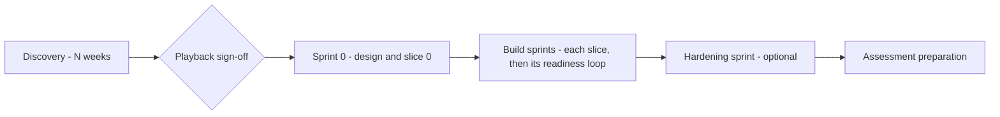

# Multi-week playbook

Use this playbook when a team runs discovery over several weeks, then builds the alpha in sprints. The [phases page](../README.md) gives the method for each phase. This page gives the schedule.

The agents and skills are the same as in the [2-day workshop playbook](../workshop-2-day/README.md). Only the schedule changes.

## Before you start

1. Run the `start-project` skill. Choose the `multi-week` mode. Give the discovery length, the sprint length and the owners.
1. Check that `.github/instructions/delivery-mode.instructions.md` has the correct values.
1. Check which models your organisation's Copilot policy allows. See [Models](../../README.md#models).

## Overview

## Roles

| Role | Person | Main agents |
|---|---|---|
| Product owner | Decides scope and priority. Approves stories and the backlog | NHS Product Owner |
| Delivery lead | Keeps the plan, logs and status current. Runs the playback | NHS Delivery Lead, NHS Discovery Analyst |
| Architect or tech lead | Agrees the architecture and accepts ADRs | NHS Architect |
| Engineers | Build and review the service | NHS Service Builder, NHS Quality Engineer |
| Clinical Safety Officer | Approves the hazard log and the safety case | NHS Clinical Safety |
| Data protection officer (DPO) or information governance (IG) lead | Approves the data protection impact assessment (DPIA) | NHS DPIA Advisor |
| Content designer | Approves user-facing content | NHS Content Designer |

Agents propose. People decide. Record who agreed each decision, and when.

## Cadence

| When | What happens | Agent and skill |
|---|---|---|
| Each discovery week | Workshops, logs, gap check and status | See the weekly rhythm in `discovery/plan.md` |
| End of discovery | Playback and sign-off | NHS Delivery Lead: `playback-pack`, `marp-slides` |
| Sprint 0 | Architecture, dependency strategy, stories, slices, slice issues and slice 0 | NHS Architect, NHS Product Owner, NHS Service Builder |
| Each sprint, start | Select the slices from the backlog, and check that their stories are `Ready` | Product owner, with NHS Product Owner |
| Each slice (pull request) | Build, then engineering review with 2 engineers, then merge, deploy and visual QA | NHS Service Builder; NHS Quality Engineer: `engineering-review`, `visual-qa` |
| First build sprint | Foundation readiness issues | NHS Delivery Lead: `alpha-readiness-issues` in foundation mode |
| After each slice is merged | Readiness loop for the slice | NHS Delivery Lead: `alpha-readiness-issues` in slice mode |
| Each sprint, during | Update the architecture decision records (ADRs) and diagrams when the design changes. The readiness loop updates the hazard log and the DPIA | NHS Architect; NHS Clinical Safety and NHS DPIA Advisor through issues S07 and S08 |
| Each week | Weekly status, and a team review of the `Draft` rows in `discovery/discovery-notes.md` | NHS Delivery Lead: `weekly-status`; the team reviews the notes |
| Each sprint, end | Engineering review with 3 engineers, then show and tell | NHS Quality Engineer: `engineering-review`; `marp-slides` |
| Before the assessment | GDS evidence and the final playback | NHS Quality Engineer: `gds-service-standard`; NHS Delivery Lead: `playback-pack` |

## Discovery (N weeks)

Use the discovery length from `delivery-mode.instructions.md`. Four weeks is a common length.

1. NHS Discovery Analyst: `problem-statement`.
1. NHS Delivery Lead: `discovery-plan`. The skill writes `discovery/plan.md` and makes the empty logs from `discovery/templates/`.
1. Follow the plan week by week. Use these skills:
   - `workshop-prep` before each workshop, and `workshop-to-actions` after it.
   - `decision` for each decision or open decision, and `decision` in collate mode before the playback to collect the open questions in `discovery/open-questions.md`.
   - `raid-and-traceability` for the RAID (risks, assumptions, issues and dependencies) log and the traceability table.
   - `interface-register` and `access-tracker` for external systems and access requests. Send the slowest requests in week 1. Give each external system a draft alpha approach: real, sandbox, mock or not used.
   - `weekly-status` at the end of each week.
   - `playback-pack` and `marp-slides` for the playback.
1. Make personas and journeys as in the [discovery guide](../../../discovery/README.md).
1. NHS Discovery Analyst: make `discovery/discovery-notes.md` from `discovery/templates/discovery-notes.md` in week 1, and draft its sections. The `workshop-to-actions` skill proposes changes after each workshop. Review the `Draft` rows as a team each week.
1. Before the playback, agree the steer: the priority journey, the riskiest assumption and the first slice candidate with its type (thin slice or journey slice). The product owner sets the "Steer" section to `Agreed`. The playback pack shows the notes for sign-off.
1. Start the hazard log and the DPIA during discovery. Do not leave them to the end.

### Gate: playback sign-off

Do not start sprint 0 until the playback is signed off. Use the gate checklist at the end of `discovery/plan.md`. If the plan was made before the gate had the open questions, the steer and the alpha approach items, add those items from `discovery/prompts/discovery-plan.md`. Record the sign-off, with names and the date, in `discovery/decision-log.md`.

## Sprint 0: design and slice 0

Sprint 0 does the design phase and slice 0 (the scaffold, the CI pipeline and the deployment). The steps are the same as phases 1 to 5 of the [Day 1 guide](../workshop-2-day/day1-guide.md). Take more time for each review.

1. **Architecture.** NHS Architect with `nhs-architecture-design`, then `nhs-adr-writer`. Before choosing technology or comparing architectures, check that `discovery/discovery-notes.md` has no active draft rows, its steer is agreed and architecture-blocking questions have an agreed direction. Read the reviewed constraints and scope, and the steer agreed at the playback: the priority journey, the riskiest assumption and the first slice candidate. Compare candidate architectures if decisions depend on each other. Output: `docs/adr/001-architecture.md`, `docs/adr/002-dependency-strategy.md`, and `docs/adr/architecture.drawio` with its PNG.
1. **Stories and slices.** NHS Product Owner with `nhs-user-stories` and `nhs-product-backlog`. Output: `user_stories/story-NNN-*.md` and `user_stories/backlog.md`. The Product Owner recommends slices with their dependencies, and you choose the type of each slice: thin slice or journey slice. After you approve the backlog, the skill creates one GitHub issue for each slice. It shows the list and waits for your confirmation. It does not assign the issues, and it does not create duplicates.
1. **ADR review and build context.** NHS Architect writes the ADRs that the stories need, checks the slice order, and completes the build context in each story. Collate new open questions with the `decision` skill in collate mode, and get a direction for each question that blocks the first slice.
1. **Slice 0a: scaffold and CI.** NHS Service Builder scaffolds the service and creates the CI pipeline in one pull request. NHS Quality Engineer runs `engineering-review`. Fix the Critical and High findings, then merge after CI passes.
1. **Slice 0b: Azure deployment.** NHS Service Builder applies the Terraform, sets up OIDC and creates the deploy pipeline. Include the runbook's "What is mocked in this alpha" section in the deployment pull request. After merge, check the deployment and the health endpoint on the live URL before closing slice 0.

The architect or tech lead accepts the ADRs. The product owner approves the stories and the backlog.

## Build sprints

Build the slices in the order in `user_stories/backlog.md`. Each slice is one GitHub issue and one pull request. The cycle is the same as phase 6 of the [Day 1 guide](../workshop-2-day/day1-guide.md), then the readiness loop in the [Day 2 guide](../workshop-2-day/day2-guide.md).

1. At the start of the sprint, the product owner selects the slices. Check that each story in them is `Ready`. If a story is `Not ready`, get a direction for its open question, then ask the NHS Architect to complete the build context.
1. Build each slice with the NHS Service Builder. Use VS Code, or assign the slice issue to the Copilot coding agent on GitHub with the NHS Service Builder agent. The build context in each story gives the design decisions, so a lower-cost model can do the build.
1. Build slices in parallel only if the backlog marks them as parallel. Use one worktree and one database for each slice. See [Parallel work](../workshop-2-day/day1-guide.md#parallel-work).
1. After each slice pull request, ask the NHS Quality Engineer to run `engineering-review` in Review mode with 2 engineers. Merge after the review and CI pass. The deploy pipeline deploys the slice.
1. Ask the NHS Quality Engineer to run `visual-qa` in VS Code on the deployed slice.
1. **Readiness loop.** NHS Delivery Lead: `alpha-readiness-issues` in slice mode for the slice. Assign each issue to Copilot with its role agent, one at a time. Add S10 for changed infrastructure or deployed dependencies, and S11 for changed operational procedures or dependencies; complete these before S07–S09. In the first build sprint, run foundation mode first. Issues F01 and F02 have operator steps in VS Code after merge: see the [Day 2 guide](../workshop-2-day/day2-guide.md).
1. At the end of the sprint, ask the NHS Quality Engineer to run `engineering-review` in Review mode with 3 engineers, on the commits of the sprint.
1. When the design changes, the NHS Architect updates the ADRs and the diagrams, then runs `scripts/export-diagrams.sh`. The readiness loop updates the hazard log, the DPIA and the GDS evidence.
1. NHS Delivery Lead: `weekly-status` each week.
1. Hold a show and tell at the end of each sprint. Use `marp-slides` to make the deck.

## Hardening sprints

Most hardening happens in the readiness loop after each slice. Use a hardening sprint only for work that the loop did not finish. Examples: a full load test, and the local activities in VS Code (the F01 and F02 operator steps, the demo recording and the SRE Agent incident rehearsal). See the [Day 2 guide](../workshop-2-day/day2-guide.md).

## Assessment preparation

1. NHS Quality Engineer: `gds-service-standard`, to update the final position in `docs/gds-assessment.md`. The skill updates the report in place and keeps the evidence from each slice.
1. NHS Documentation: build the documentation site. See the [Day 2 guide](../workshop-2-day/day2-guide.md#when-all-done--mkdocs-documentation-site).
1. NHS Delivery Lead: `playback-pack` and `marp-slides` for the final playback before the assessment.
1. Check that the hazard log, the DPIA and the ADRs are current and approved by their owners.
