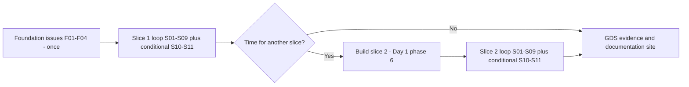

# Day 2 — Complete the Alpha with Copilot Coding Agent

## Overview

Day 2 focuses on **completing the alpha** — hardening, testing, documenting, and showing GDS readiness. The work is a **readiness loop**: run the foundation issues once, then the slice issues for each slice that you built. If you have time, build the next slice and run its loop too. Use the **Copilot Coding Agent** on GitHub. Create issues and assign Copilot to each listed role agent. Copilot creates the pull requests.



> **Reference**: [How the alpha phase works](https://www.gov.uk/service-manual/agile-delivery/how-the-alpha-phase-works) — by the end of alpha, you should be confident you can create something that meets users' needs and is cost-effective.

### What "completing the alpha" means

At the end of Day 2, your service should have evidence for:
- **Tested riskiest assumptions** — working prototype that addresses the user journeys from Day 1 discovery
- **Solving a whole problem for users** — end-to-end journeys that work, scoped correctly
- **Meeting the standard** — GDS 14-point evidence, accessibility audit, clinical safety, DPIA
- **Technical readiness** — tests, CI pipeline, security hardening, performance baseline

This evidence covers the slices that you built. A workshop may build only 1 slice. That is enough to test the riskiest assumption. List the remaining slices in the backlog as the next steps.

## Setup (15 minutes)

1. Ensure all Day 1 code is committed and pushed
2. Enable Copilot Coding Agent on your repository (Settings → Copilot → Coding Agent)

## Generate the Foundation Issues (15 minutes)

The issues are generated from your actual tech stack and codebase — not from static templates.

1. In VS Code, switch to the **NHS Delivery Lead** agent
2. Ask it to use `alpha-readiness-issues` in **foundation mode**
3. It reads `tech-stack.instructions.md`, the ADRs, the backlog and your codebase to produce tailored issue files in [`docs/alpha-readiness-issues/foundation/`](../../alpha-readiness-issues/README.md)
4. Review the generated files and confirm
5. The agent creates the issues on GitHub using `gh` CLI — it does **not** assign them to Copilot

> **Prerequisite**: Ensure `gh auth login` has been run in the terminal before starting.

| # | Issue | Role Agent + Skill | Alpha Evidence |
|---|---|---|---|
| F01 | CI/CD Hardening | NHS Service Builder — `github-actions-pipeline` | Operational reliability. The CI and deploy pipelines exist from slice 0. This issue adds environment protection, approvals and a staged rollout. An operator finishes it in VS Code (see below) |
| F02 | Alerting & Azure SRE Agent | NHS Service Builder — `azure-sre-agent` | Operate a reliable service — alerts and AI-assisted incident diagnosis _(optional — alerting only if the team has no SRE Agent access)_ |
| F03 | Azure Infra Security Review | NHS Quality Engineer — `azure-infrastructure-review` | Infrastructure security, network isolation |
| F04 | Runbook & Deployment Docs | NHS Service Builder — `azure-nhs-deploy` | Operational readiness, and what is mocked in this alpha |

F01 and F02 each have operator steps. The Copilot coding agent cannot apply Terraform, reach Azure or change repository settings. After you merge the F01 pull request, apply its Terraform plan from VS Code and set the GitHub environment protection rules and branch protection on `main`. You need repository admin rights.

Alerting and the SRE Agent (F02) come before the infrastructure security review, so the alerts and any agent roles and networking are audited, and before the runbook and the compliance documents, which build on it. Issue F02 has two variants: alerting and SRE Agent, or alerting only. The Delivery Lead asks which one applies and adjusts the later issues.

## Run the Loop for Each Slice

After the foundation issues, run the loop for each slice that you merged. Start with slice 1.

1. Ask the **NHS Delivery Lead** to use `alpha-readiness-issues` in **slice mode** for slice N
2. It reads the slice issue, its stories and the diff of its merged pull request, and writes issues scoped to that slice in `docs/alpha-readiness-issues/slice-N/`
3. Review, confirm, and work through the issues in order

| # | Issue | Role Agent + Skill | Alpha Evidence |
|---|---|---|---|
| S01 | Test Gaps | NHS Quality Engineer — `automated-testing`, `playwright-nhs-e2e` | The slice's path works end to end |
| S02 | Code Quality Review | NHS Quality Engineer — `code-quality-review` | Code standards, type safety, test coverage |
| S03 | Security Review | NHS Quality Engineer — `security-review` | Threat awareness |
| S04 | Accessibility Audit | NHS Quality Engineer — `accessibility-audit` | WCAG 2.2 AA / everyone can use it |
| S05 | Performance Check | NHS Quality Engineer — `performance-testing` | The slice can handle the expected load |
| S06 | Content Review | NHS Content Designer | Plain English, NHS content style |
| S07 | DCB0129 Clinical Safety | NHS Clinical Safety — `dcb0129-hazard-log` | Clinical risk managed — the hazard log is updated, not rewritten |
| S08 | DPIA | NHS DPIA Advisor — `nhs-dpia` | Data protection considered — the DPIA is updated, not rewritten |
| S09 | GDS Assessment Evidence | NHS Quality Engineer — `gds-service-standard` | 14-point standard mapped — the evidence grows with each slice |
| S10 | Infrastructure Security Review (conditional) | NHS Quality Engineer — `azure-infrastructure-review` | Changed infrastructure and deployed dependencies are reviewed |
| S11 | Runbook & Deployment Docs Update (conditional) | NHS Service Builder — `azure-nhs-deploy` | Operational guidance reflects the slice |

Add S10 when the slice changes infrastructure, identity, networking or deployed dependencies, including external mocks. Add S11 when it changes deployment, configuration, dependencies, monitoring, recovery or support procedures. Complete triggered S10 and S11 before S07–S09. Update the existing baseline and runbook only where affected; do not repeat the whole foundation phase.

The slice's definition of done already covers unit tests, E2E tests with axe, CI and the engineering review. The loop looks for gaps. If an issue has nothing to add for the slice, close it with a short reason.

**If there is time**, build the next slice with the Day 1 [Phase 6](day1-guide.md#phase-6--build-slices-35-hours) cycle, then run its loop.

## Working Through Issues

The Delivery Lead creates the issues on GitHub only after you confirm the proposed list. It does **not** assign them — you must assign Copilot with the listed **role agent**:

1. Open the first issue on GitHub
2. Click **"Assign Copilot"** and select the role agent from the dropdown. The issue lists the agent and skill.
3. Copilot creates a PR using that role agent and its selected skill. CI runs on the PR
4. Review the PR, request changes if needed, then merge. The deploy pipeline deploys it
5. Move to the next issue — assign one at a time

> **Important**: Assign issues one at a time. Copilot works on one issue per repo. Wait for the PR to be merged before assigning the next.

## GDS Alpha Assessment Readiness

By the end of Day 2, review your evidence against the [GDS Service Standard](https://www.gov.uk/service-manual/service-standard):

| Standard Point | Evidence Source |
|---|---|
| 1. Understand users and their needs | Discovery: personas, user journeys (Day 1) |
| 2. Solve a whole problem for users | Working prototype with scoped journeys |
| 3. Provide a joined up experience | NHS Design System, consistent components |
| 4. Make the service simple to use | NHS Design System components, content review (S06) |
| 5. Make sure everyone can use the service | Accessibility audit (S04), axe results |
| 6. Have a multidisciplinary team | Roles in `delivery-mode.instructions.md`, clinical safety and IG input |
| 7. Use agile ways of working | Slice issues, PRs, the readiness loop, iterative delivery |
| 8. Iterate and improve frequently | ADRs, Git history, slice pull requests, what each slice taught the team |
| 9. Create a secure service | Security audit, OWASP checklist |
| 10. Define what success looks like | Performance metrics, k6 thresholds |
| 11. Choose the right tools and technology | ADRs documenting technology choices |
| 12. Make new source code open | Public repo, open source licence |
| 13. Use and contribute to open standards | NHS Design System, FHIR references |
| 14. Operate a reliable service | CI/CD, monitoring, alerting, runbook, SRE Agent incident rehearsal record |

The **NHS Quality Engineer** with the `gds-service-standard` skill (issue S09 in each slice loop) builds the evidence report and adds to it after each slice. At the end of Day 2, run it once more to update the final position — it updates the report in place and keeps the slice entries.

## Tips

- **Don't create all issues at once** — Copilot works on one at a time per repo. Create the foundation issues, then one slice loop at a time
- **Review PRs carefully** — Copilot is good but not perfect
- **Iterate on PRs** — request changes via review comments, Copilot will update
- **Keep diagrams current** — Day 2 work (CI/CD, infrastructure security, network isolation) changes the deployed architecture; ask the **NHS Architect** agent in VS Code to update `docs/adr/architecture.drawio` so it reflects the final design, and export the PNGs with `scripts/export-diagrams.sh docs/adr`, before you build the documentation site
- **Link back to discovery** — Day 1 artefacts (scenarios, personas, journeys) are key evidence for GDS points 1, 2, and 3

---

## Demo Recording (VS Code Activity)

While Copilot works through the readiness issues, use the **NHS Quality Engineer** with the `demo-recording` skill in VS Code to produce a recorded walkthrough. This runs locally because it needs access to the running application — the hosted Copilot Coding Agent may not be able to reach it.

**Agent**: NHS Quality Engineer _(in VS Code, not as a GitHub issue)_

**Skill**: `demo-recording`.

> Record a demo of the service. Read the user journeys, stories, and frontend/backend routes. Generate a demo narrative script, then create a Playwright recording that walks through each journey with video capture.

The agent will:

1. Discover all routes and user journeys from the codebase
2. Generate a demo narrative script at `docs/demo/demo-script.md`
3. Create a Playwright test at `tests/e2e/demo/test_demo_recording.py` with video recording enabled
4. Run the walkthrough — if any issues are found, fix them iteratively
5. Save recorded videos to `tests/e2e/demo/videos/` and screenshots to `tests/e2e/demo/screenshots/`
6. Report any issues found and fixed in `docs/demo/demo-issues-resolved.md`

> **Tip**: Run this after the test gaps issue (S01) of each slice is complete so the journeys are already verified. The demo recording serves as a final end-to-end validation and produces shareable evidence for assessors.

---

## SRE Agent Incident Rehearsal (VS Code Activity)

Issue F02 delivers alerting and the Azure SRE Agent **as code**. The Copilot Coding Agent cannot apply Terraform or reach Azure, so an operator finishes the work from VS Code once the PR is merged.

**Agent**: NHS Service Builder _(in VS Code, with your own `az login`)_

**Skill**: `azure-sre-agent`.

Skip this activity if your team did issue F02 as alerting only.

> Help me bring the SRE Agent live in the alpha environment and rehearse one incident. Walk me through the operator steps in the issue F02 PR, then a fault from `scripts/sre-agent-fault.sh`, and record the result in the runbook.

1. **Apply** — review the Terraform plan for the alpha environment, then apply it. You need permission to create role assignments
2. **Prove private access** — if telemetry is private, ask the agent in the [SRE Agent portal](https://sre.azure.com) to query request logs for the last hour. If it cannot, **stop**: disable the agent (`sre_agent_enabled = false`) and keep the alerts. Never open the workspace to public query
3. **Configure** — run `scripts/sre-agent-apply-config.sh`, then `scripts/sre-agent-verify-config.sh`; verify must report no drift
4. **Rehearse** — start `scripts/sre-agent-load.sh`, inject one fault, wait for the alert (allow 15–25 minutes), and check the agent's investigation names the failing component, the change that caused it and the runbook section, and recommends a fix through Terraform. Ask the agent to fix it and confirm it refuses
5. **Restore and record** — restore through Terraform or the runbook, confirm `terraform plan` shows no changes, fill in the rehearsal record in the runbook and delete the investigation threads

> **Tip**: Complete the rehearsal before the GDS Assessment Evidence issue (S09) so the record is available as evidence. Do it once before any show-and-tell so a completed investigation is ready — alert evaluation takes several minutes. If you need a video, use a screen recording. The `demo-recording` skill records only the local service with Playwright.

---

## When All Done — MKDocs Documentation Site

Once all issues are merged, use the **NHS Documentation** agent to build a single MKDocs site that pulls every alpha artefact together into one browsable, shareable site.

**Agent**: NHS Documentation

> Build the MKDocs documentation site for this service. Read the codebase, user stories, ADRs, clinical safety, DPIA, and GDS evidence artefacts to generate all pages. Use NHS blue branding. Verify with `mkdocs build`.

The agent will:

1. Install `mkdocs-material` and scaffold `mkdocs.yml`
2. Generate pages from existing artefacts — no content is invented:
   - **Home** — project overview from `README.md`
   - **Architecture** — from `docs/adr/001-architecture.md`, `docs/adr/002-dependency-strategy.md` (including what is mocked) and the exported PNG diagrams
   - **API Reference** — scanned from `app/routers/` with all endpoints documented
   - **User Guide** — user-facing flows from `discovery/user_journeys/` and `frontend/src/pages/`
   - **Deployment** — from `infra/` and build commands in `AGENTS.md`
   - **Testing** — test structure, how to run, and coverage targets
   - **Security** — security measures derived from the security hardening PR
   - **Operations** — alerting, SRE Agent guardrails and the incident rehearsal record from the runbook
   - **Accessibility** — WCAG 2.2 AA audit results
   - **Clinical Safety** — from `docs/clinical-safety/`
   - **DPIA** — from `docs/dpia/`
   - **ADRs** — index of all records in `docs/adr/`
3. Apply NHS blue (`#005eb8`) theming
4. Run `mkdocs build` to verify no broken links

Preview locally with:
```bash
mkdocs serve
```

The site provides a single artefact you can share with assessors, stakeholders, and the wider team as evidence of a complete NHS Alpha.
